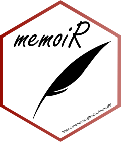

```{r}
#| label: Options
### Customized R options for this document
# Delete this chunk if you don't use R

# Necessary packages. Add all packages used in the code here.
packages_required <- c(
  # R tools, do not modify
  "knitr",   # to run the code chunks
  "formatR", # if tidy = TRUE below
  # Add specific packages here
  "tidyverse", 
  "gt",
  # Necessary packages
  "vegan", "permute",
  "ggrepel", "grid", "dplyr", "readxl", "glmmTMB",
  "DHARMa", "car", "emmeans", "gt", "ggnewscale"
)

# Already installed?
packages_installed <- vapply(
  packages_required, 
  FUN = requireNamespace, 
  FUN.VALUE = TRUE, 
  quietly = TRUE
) 
# Install missing packages
install.packages(
  names(packages_installed)[!packages_installed],
  repos = "https://cran.rstudio.com/",
  quiet = TRUE
)

# Allow size='small' or any valid Latex font size in chunk options
def.chunk.hook <- knitr::knit_hooks$get("chunk")
knitr::knit_hooks$set(
  chunk = function(x, options) {
    x <- def.chunk.hook(x, options)
    ifelse(
      options$size == "normalsize", 
      yes = x,
      no = paste0("\n \\", options$size, "\n\n", x, "\n\n \\normalsize")
    )
  }
)

# knitr options (https://yihui.org/knitr/options/)
knitr::opts_chunk$set(
  # Code chunk automatic format if tidy is TRUE
  tidy = TRUE, 
  # Tidy code options: remove blank lines and cut lines after 50 characters
  tidy.opts = list(blank = FALSE, width.cutoff = 50),
  # Font size in PDF output
  size = "scriptsize", 
  # Select PDF figures in PDF output if PDF file exists beside PNG file
  knitr.graphics.auto_pdf = TRUE
)
# Text width of R functions output
options(width = 50)

#load all packages
invisible(lapply(packages_required, library, character.only = TRUE))

# Function to call in each chunk that produces a figure
ggtheme_set <- function() {
  theme_set(theme_bw())
  theme_update(
    panel.background = element_rect(fill = "transparent", colour = NA),
    plot.background = element_rect(fill = "transparent", colour = NA)
  )
}
knitr::opts_chunk$set(dev.args = list(bg = "transparent"))

# Random seed
set.seed(123)
```

```{r}
#| label: loading data
df <- read_excel("../data/macrofaune_counts.xlsx")
df[7:ncol(df)] <- lapply(df[7:ncol(df)], as.numeric)
df[c(1, 3:6)] <- lapply(df[c(1, 3:6)], as.factor)
str(df)
```

```{r}
#| label: setting design scheme (color-blind verified)

# readability was verified for deuteranopia, protanopia, tritanopia and on greyscale

layer_colors <- c(
  "L"  = "#AFC8B5",
  "10" = "#B47A2C",
  "20" = "#355C7D"
)

soil_colors <- c(
  "alt" = "#C5A36A",
  "dls" = "#394B45"
)

taxon_colors <- c(
  "Formicidae" = "#B56B32",
  "Isoptera" = "#496987",
  "Lumbricina_oligochaetes" = "#527F68",
  "Others" = "#A6A39B"
)

gg_fontsize <- list(text = element_text(size = 14),
    axis.title = element_text(size = 16),
    axis.text = element_text(size = 13),
    strip.text = element_text(size = 15, face = "bold"),
    legend.title = element_text(size = 14),
    legend.text = element_text(size = 13))
```

# Introduction
Lorem ipsum dolor sit amet, consectetur adipiscing elit, sed do eiusmod tempor incididunt ut labore et dolore magna aliqua. Ut enim ad minim veniam, quis nostrud exercitation ullamco laboris nisi ut aliquip ex ea commodo consequat. Duis aute irure dolor in reprehenderit in voluptate velit esse cillum dolore eu fugiat nulla pariatur. Excepteur sint occaecat cupidatat non proident, sunt in culpa qui officia deserunt mollit anim id est laborum.

## Context 1

text

## Context 2

text

# Material and Methods

## Study Site
Refer to @fig-map

::: {#fig-map}
```{r}
#| label: map FIGURE
#| out-width: 30%
#| include: true

```

PLACEHOLDER Enter our map here.
:::

PLACEHOLDER citation @Ramos2025 or [@Ramos2025], or @Freycon2003 or @Pavlicek2012

## Sampling and Identification

text

## Statistical analysis

negative binomial (NB2) and Poisson tested

### Explorative Analysis

text

### Analysis of Abundances (Generalized Linear Mixed Models)

text

### Analysis of Community Composition (PERMANOVA)

text

# Results

```{r}
#| label: Preparing data for explorative analysis and GLMM
# identify taxa columns
taxa_cols <- names(df)[7:34]

# long-format dataset
df_long <- df %>%
  pivot_longer(
    cols = all_of(taxa_cols),
    names_to = "taxon",
    values_to = "count"
  ) %>%
  mutate(
    taxon = factor(taxon)
  )

# sample-level abundance (per m²)
df_total <- df %>%
  mutate(
    total_count = rowSums(
      across(all_of(taxa_cols)),
      na.rm = FALSE
    ),
    density = total_count * 16, #25x25cm monoliths = 1/16 m²
    soil_type = factor(soil_type),
    layer = factor(layer, levels = c("L", "10", "20")),
    monolith_ID = factor(monolith_ID)
  )
```

## General

Densities by soil type and layer @fig-density

::: {#fig-density fig-env="figure"}
```{r}
#| label: Total macrofauna density boxplot FIGURE
#| include: true

# Boxplot of total macrofauna density
fig_density <- ggplot(
  df_total,
  aes(
    x = layer,
    y = density,
    fill = soil_type
  )
) +
  geom_boxplot(
    width = 0.7,
    position = position_dodge(width = 0.8),
    outlier.shape = 1
  ) +
  scale_fill_manual(values = soil_colors) +
  scale_y_continuous(
  trans = scales::pseudo_log_trans(base = 10),
  breaks = c(0, 10, 100, 1000, 5000),
  labels = scales::label_comma()
) +
  labs(
    x = "Soil layer",
    y = expression("Total density (ind. m"^{-2}*")"),
    fill = "Soil type"
  ) +
  theme_bw() +
  theme(!!!gg_fontsize)

print(fig_density)
```

Boxplot with total macrofauna densities by soil type and layer. y-axis is logarithmic.
:::

Relative composition of community abundances @fig-comp

::: {#fig-comp fig-env="figure"}
```{r}
#| label: Composition FIGURE
#| include: true

# Group taxa into the three focal groups and others
composition <- df_long %>%
  mutate(
    taxon_group = case_when(
      taxon == "Formicidae" ~ "Formicidae",
      taxon == "Isoptera" ~ "Isoptera",
      taxon == "Lumbricina_oligochaetes" ~ "Lumbricina_oligochaetes",
      TRUE ~ "Others"
    ),
    layer = factor(layer, levels = c("L", "10", "20")),
    taxon_group = factor(
      taxon_group,
      levels = names(taxon_colors)
    )
  ) %>%
  group_by(soil_type, layer, taxon_group) %>%
  summarise(
    total = sum(count, na.rm = TRUE),
    .groups = "drop"
  ) %>%
  group_by(soil_type, layer) %>%
  mutate(
    proportion = total / sum(total)
  ) %>%
  ungroup()

# Plot taxonomic composition
fig_composition <- ggplot(
  composition,
  aes(
    x = soil_type,
    y = proportion,
    fill = taxon_group
  )
) +
  geom_col(
    colour = "white",
    width = 0.7
  ) +
  facet_wrap(~ layer) +
  scale_y_continuous(
    labels = scales::percent,
    limits = c(0, 1)
  ) +
  scale_fill_manual(
    values = taxon_colors,
    drop = FALSE
  ) +
  labs(
    x = "Soil type",
    y = "Proportion of individuals",
    fill = "Taxon"
  ) +
  theme_bw() +
 theme(!!!gg_fontsize)

print(fig_composition)
```

Relative composition of macrofaunal community abundances by soil type and layer.
:::

Explorative ordination PCA @fig-pca
```{r}
#| label: prepare PCA using Hellinger transformation

# Community matrix
comm <- as.matrix(df[, taxa_cols])
storage.mode(comm) <- "numeric"

# Remove samples with zero total abundance
keep <- rowSums(comm) > 0 # one removed

comm_pca <- comm[keep, , drop = FALSE]

# Hellinger transformation
comm_hel <- vegan::decostand(comm_pca, method = "hellinger")

# PCA
pca <- prcomp(
  comm_hel,
  center = TRUE,
  scale. = FALSE
)

# Percentage of variance explained
variance_pca <- 100 * pca$sdev^2 / sum(pca$sdev^2)

# Scores and metadata
scores_pca <- as.data.frame(pca$x[, 1:2]) %>%
  mutate(
    soil_type = df$soil_type[keep],
    layer = factor(df$layer[keep], levels = c("L", "10", "20")),
    monolith_ID = df$monolith_ID[keep]
  )

# Taxon coordinates from PCA loadings
taxa_scores <- as.data.frame(pca$rotation[, 1:2]) %>%
  tibble::rownames_to_column("taxon") %>%
  mutate(
    cos2 = PC1^2 + PC2^2
  )

# Scale taxon arrows to fit sample scores
arrow_scale <- min(
  diff(range(scores_pca$PC1)) / diff(range(taxa_scores$PC1)),
  diff(range(scores_pca$PC2)) / diff(range(taxa_scores$PC2))
) * 0.7

taxa_scores <- taxa_scores %>%
  mutate(
    PC1_arrow = PC1 * arrow_scale,
    PC2_arrow = PC2 * arrow_scale
  )

# Keep taxa reasonably represented on the first two PCA axes
taxa_scores_plot <- taxa_scores %>%
  filter(cos2 >= 0.10) # can change cos2 here
``` 

::: {#fig-pca fig-env="figure"}
```{r}
#| label: PCA FIGURE
#| include: true

#| label: PCA biplot

fig_pca <- ggplot(
  scores_pca,
  aes(
    x = PC1,
    y = PC2,
    colour = soil_type,
    shape = layer
  )
) +

  # Reference lines at the origin
  geom_hline(
    yintercept = 0,
    linetype = "dotted",
    colour = "grey65",
    linewidth = 0.4,
    inherit.aes = FALSE
  ) +
  geom_vline(
    xintercept = 0,
    linetype = "dotted",
    colour = "grey65",
    linewidth = 0.4,
    inherit.aes = FALSE
  ) +

  # Confidence ellipses by soil type
 stat_ellipse(
  data = scores_pca,
  mapping = aes(
    x = PC1,
    y = PC2,
    group = soil_type,
    colour = soil_type
  ),
  level = 0.95,
  type = "t",
  linetype = "dashed",
  linewidth = 0.7,
  show.legend = FALSE,
  inherit.aes = FALSE
) + 

  # Sample scores
  geom_point(
    size = 3,
    alpha = 0.8
  ) +

  # Discrete colour scale for soil type
  scale_colour_manual(
    values = soil_colors,
    name = "Soil type"
  ) +

  # Start a separate colour scale for taxon arrows
  ggnewscale::new_scale_colour() +

  # Taxon arrows, coloured by cos2
  geom_segment(
    data = taxa_scores_plot,
    aes(
      x = 0,
      y = 0,
      xend = PC1_arrow,
      yend = PC2_arrow,
      colour = cos2
    ),
    inherit.aes = FALSE,
    arrow = grid::arrow(
      length = grid::unit(0.2, "cm")
    ),
    linewidth = 0.6
  ) +

  # Taxon labels, coloured by cos2
  ggrepel::geom_text_repel(
    data = taxa_scores_plot,
    aes(
      x = PC1_arrow,
      y = PC2_arrow,
      label = taxon,
      colour = cos2
    ),
    inherit.aes = FALSE,
    size = 4,
    max.overlaps = Inf,
    show.legend = FALSE
  ) +

  # Continuous colour scale for taxon cos2
  scale_colour_gradient(
    low = "grey80",
    high = "#2166AC",
    name = expression(cos^2)
  ) +

  # Layer shapes
  scale_shape_manual(
    values = c(
      "L" = 16,
      "10" = 17,
      "20" = 15
    ),
    name = "Layer"
  ) +

  # Axis labels
  labs(
    x = paste0(
      "PC1 (",
      round(variance_pca[1], 1),
      "%)"
    ),
    y = paste0(
      "PC2 (",
      round(variance_pca[2], 1),
      "%)"
    )
  ) +

  # Theme
  theme_bw() +
  theme(!!!gg_fontsize)

fig_pca
```

PCA ordination based on Hellinger-transformed community matrix. First two dimensions are presented. Only taxa with cos² > 0.1 are presented.
:::

## GLMM
Effects of soil type and layer were tested on global, ant, termite and earthworm abundances. All retained models described below are listed in @tbl-models.


### Global Abundance
```{r}
#| label: Global GLMM
m_nb_add <- glmmTMB(
  total_count ~ soil_type + layer + (1 | monolith_ID),
  family = nbinom2(link = "log"),
  data = df_total
)

Anova(m_nb_add)
summary(m_nb_add)
```

Type II Wald chi-square tests revealed a highly significant effect of soil layer on total soil macrofauna abundance ($\chi^2$ = 106.85, df = 2, p < 0.001). The effect of soil type was not significant ($\chi^2$ = 0.52, df = 1, p = 0.469). Estimated random-effect variance (monolith) was 0.437 (SD = 0.661), indicating variation in baseline macrofauna abundance among monoliths.

Pairwise comparisons with Tukey adjustment (@tbl-pairwise) showed that macrofauna abundance was significantly higher in layer 10 than in layers L (7.42 times) and 20 (6.18 times), while no significant difference was found between layers L and 20 (p = 0.714).


### Formicidae
```{r}
#| label: Ant GLMM
#| include: false

df_ants <- df_total %>%
  select(Formicidae, layer, monolith_ID, soil_type)

ants_nb_add <- glmmTMB(
  Formicidae ~ soil_type + layer + (1 | monolith_ID),
  family = nbinom2(link = "log"),
  data = df_ants
)

Anova(ants_nb_add)
summary(ants_nb_add)
```
Type II Wald chi-square tests revealed a highly significant effect of soil layer on ant abundance ($\chi^2$ = 28.00, df = 2, p < 0.001). The effect of soil type was not significant ($\chi^2$ = 0.48, df = 1, p = 0.486). The estimated random-effect variance for monolith was 0.655 (SD = 0.810), indicating variation in baseline ant abundance among monoliths. Quantile deviation was detected in the DHARMa residuals for the presented model. Specifically, upper quantile deviated significantly and thus relatively high-abundance observations may not be adequately captured by the model. Since the diagnostics did not indicate deviations regarding dispersion, zero-inflation, uniformity as well outliers, and the model has the best AIC support, it was retained, regardless.

Pairwise comparisons with Tukey adjustment (@tbl-pairwise) showed that ant abundance was significantly higher in layer 10 than in layer L (5.05 times) and layer 20 (3.27 times), while no significant difference was found between layers L and 20 (p = 0.3995).

### Isoptera
```{r}
#| label: Termite GLMM
#| include: false

df_termites <- df_total %>%
  select(Isoptera, layer, monolith_ID, soil_type)

termites_nb_add <- glmmTMB(
  Isoptera ~ soil_type + layer + (1 | monolith_ID),
  family = nbinom2(link = "log"),
  data = df_termites
)

Anova(termites_nb_add)
summary(termites_nb_add)
```

Type II Wald chi-square tests revealed a highly significant effect of soil layer on termite abundance ($\chi^2$ = 36.56, df = 2, p < 0.001). The effect of soil type was not significant ($\chi^2$ = 0.89, df = 1, p = 0.347). The estimated random-effect variance for monolith was effectively zero ($8.22 \times 10^{-9}$; SD = 0.00009), indicating virtually no remaining variation in baseline termite abundance among monoliths after accounting for the fixed effects.

Pairwise comparisons with Tukey adjustment (@tbl-pairwise) showed that termite abundance was significantly higher in layer 10 than in layer L (18.08 times) and layer 20 (745.48 times; estimated richness for 20 nearing zero). Abundance was also significantly higher in layer L than in layer 20 (41.23 times; all p \leq 0.0073).

::: {#tbl-pairwise fig-env="table*"}
```{r}
#| label: GLMM pairwise comparisons TABLE
#| size: normalsize
#| include: true

# Estimated marginal means for layers (response scale)
emm_layers_total <- emmeans(m_nb_add, ~ layer, type = "response")
emm_layers_ants <- emmeans(ants_nb_add, ~ layer, type = "response")
emm_layers_termites <- emmeans(termites_nb_add, ~ layer, type = "response")

# Pairwise comparisons (Tukey correction)
pairwise_layers_total <- as.data.frame(
  pairs(emmeans(m_nb_add, ~ layer), adjust = "tukey")
)

pairwise_layers_ants <- as.data.frame(
  pairs(emmeans(ants_nb_add, ~ layer), adjust = "tukey")
)

pairwise_layers_termites <- as.data.frame(
  pairs(emmeans(termites_nb_add, ~ layer), adjust = "tukey")
)

# Back-transform estimates to abundance ratios
pairwise_layers_total$ratio <- exp(pairwise_layers_total$estimate)
pairwise_layers_ants$ratio <- exp(pairwise_layers_ants$estimate)
pairwise_layers_termites$ratio <- exp(pairwise_layers_termites$estimate)

# Combine results
pairwise_results <- bind_rows(
  pairwise_layers_total %>% mutate(Taxon = "Total macrofauna"),
  pairwise_layers_ants %>% mutate(Taxon = "Ants (Formicidae)"),
  pairwise_layers_termites %>% mutate(Taxon = "Termites (Isoptera)")
)

# Format table
glmm_pairwise_table <- pairwise_results %>%
  mutate(
    ratio = round(ratio, 2),
    z.ratio = round(z.ratio, 2),

    stars = case_when(
      p.value < 0.001 ~ "***",
      p.value < 0.01 ~ "**",
      p.value < 0.05 ~ "*",
      TRUE ~ ""
    ),

    p_display = ifelse(
      p.value < 0.0001,
      "<0.0001",
      format.pval(p.value, digits = 3)
    ),

    p_display = paste0(
      p_display,
      "<sup>", stars, "</sup>"
    )
  ) %>%
  select(
    Taxon,
    Comparison = contrast,
    `Abundance ratio` = ratio,
    `z-ratio` = z.ratio,
    `Adjusted p-value` = p_display
  ) %>%
  gt() %>%
  cols_align(
    align = "center",
    columns = everything()
  ) %>%
  fmt_markdown(
    columns = `Adjusted p-value`
  ) %>%
  tab_source_note(
    source_note = md(
      "Abundance ratios are exponentiated log-scale contrasts. Significance levels: * p < 0.05; ** p < 0.01; *** p < 0.001. P-values adjusted using the Tukey method within each taxon."
    )
  )

if (knitr::is_latex_output()) {
  glmm_pairwise_table %>%
    opt_table_font(size = px(10))
} else {
  glmm_pairwise_table
}
```

Pairwise emmeans comparisons of abundance by layer for total macrofauna, ants (Formicidae) and termites (Isoptera).
:::


### Lumbricina Oligochaetes

results text

```{r}
#| label: Earthworm GLMM
#| include: false

df_earthworms <- df_total %>%
  select(Lumbricina_oligochaetes, layer, monolith_ID, soil_type)

earthworms_p_add <- glmmTMB(
  Lumbricina_oligochaetes ~ soil_type + layer + (1 | monolith_ID),
  family = poisson(link = "log"),
  data = df_earthworms
)

Anova(earthworms_p_add)
summary(earthworms_p_add)
```

::: {#tbl-models fig-env="table*"}
```{r}
#| label: SummaryModels
#| include: true
#| size: normalsize

models <- list(
  "Total macrofauna" = m_nb_add,
  "Ants" = ants_nb_add,
  "Termites" = termites_nb_add,
  "Earthworms" = earthworms_p_add
)

glmm_summary <- lapply(names(models), function(model_name) {

  model <- models[[model_name]]

  anova_results <- as.data.frame(
    car::Anova(model, type = 2)
  )

  anova_results$Predictor <- rownames(anova_results)

  distribution <- if (model_name == "Earthworms") {
    "Poisson"
  } else {
    "Negative binomial"
  }

  anova_results %>%
    transmute(
      Response = model_name,
      Distribution = distribution,
      Predictor = Predictor,
      `Chi-square` = round(Chisq, 2),
      df = Df,
      p_value = `Pr(>Chisq)`
    )

}) %>%
  bind_rows()

glmm_table <- glmm_summary %>%
  mutate(
    stars = case_when(
      p_value < 0.001 ~ "***",
      p_value < 0.01  ~ "**",
      p_value < 0.05  ~ "*",
      TRUE ~ ""
    ),
    p_display = ifelse(
      p_value < 0.0001,
      "<0.0001",
      format.pval(p_value, digits = 3)
    ),
    p_display = paste0(p_display, "<sup>", stars, "</sup>")
  ) %>%
  select(
    Response,
    Distribution,
    Predictor,
    `Chi-square`,
    df,
    `p-value` = p_display
  ) %>%
  gt() %>%
  cols_align(
    align = "center",
    columns = everything()
  ) %>%
  fmt_markdown(columns = `p-value`) %>%
  tab_source_note(
    source_note = md(
      "Type II Wald chi-square tests. All models included soil type and soil layer as fixed effects and monolith ID as a random intercept. Significance levels: * p < 0.05; ** p < 0.01; *** p < 0.001"
    )
  )

if (knitr::is_latex_output()) {
  glmm_table %>%
    opt_table_font(size = px(10))
} else {
  glmm_table
}
```

Summary of retained GLMMs for global abundance, ants (Formicidae), termites (Isoptera) and earthworms (Lumbricina oligochaetes). ADD MORE DESCRIPTION HERE
:::

## PERMANOVA
```{r}
#| label: Data preparation for PERMANOVA and PCoA
df_perm <- df
# defining taxonomic abundance columns
community_cols <- names(df_perm)[7:ncol(df_perm)]

# remove zero-abundance samples (decision following vegan
#handbook, since zero-abundance layer does not convey community
#composition information)
keep <- rowSums(df_perm[, community_cols], na.rm = TRUE) > 0
df_perm <- df_perm[keep, , drop = FALSE]

# create the community matrix
comm <- as.matrix(df_perm[, community_cols])
storage.mode(comm) <- "numeric" # making sure its num

# define meta_layer for tested variables + monoliths
meta_layer <- df_perm[, c("monolith_ID", "soil_type", "layer")] 

# create Bray-Curtis dissimilarity matrix
dist_layer <- vegdist(comm, method = "bray")
```


```{r}
#| label: Create new community matrix for soil type accumulated per monolith and fit model
# sum across all layers within each monolith => to test
#independent of layer effects, since dependent of monolith
comm_mono <- rowsum(
  comm,
  group = df_perm$monolith_ID,
  reorder = FALSE
)

# one metadata row per monolith
meta_mono <- df_perm[
  !duplicated(df_perm$monolith_ID),
  c("monolith_ID", "soil_type")
]

# aligning matrix with metadata
comm_mono <- comm_mono[
  as.character(meta_mono$monolith_ID),
  ,
  drop = FALSE
]

dist_soil <- vegdist(comm_mono, method = "bray")
# Bray-Curtis PERMANOVA

permanova_soil <- adonis2(
  dist_soil ~ soil_type,
  data = meta_mono,
  permutations = 9999
) 

print(permanova_soil)
# not significant, no differences by soil type

# betadisper

bd_soil <- betadisper(
  dist_soil,
  group = meta_mono$soil_type,
  type = "median",
  bias.adjust = TRUE
)

dispersion_soil <- permutest(
  bd_soil,
  permutations = 9999
)

print(dispersion_soil)

# simple plot
plot(bd_soil)
```

PERMANOVA did not show a significant difference in macrofaunal community composition between soil types (F = 1.68, R² = 0.085, p = 0.139). The test for homogeneity of multivariate dispersion was also non-significant (F = 0.11, p = 0.742), indicating no detectable difference in within-group dispersion between soil types. Layers were aggregated per monolith to account for spatial dependence.


```{r} 
#| label: Run permanova and PCoA

df_perm <- df
# defining taxonomic abundance columns
community_cols <- names(df_perm)[7:ncol(df_perm)]

# remove zero-abundance layers (decision following vegan handbook, since zero-abundance layer does not convey community composition information)
keep <- rowSums(df_perm[, community_cols], na.rm = TRUE) > 0
df_perm <- df_perm[keep, , drop = FALSE]

# create the community matrix
comm <- as.matrix(df_perm[, community_cols])
storage.mode(comm) <- "numeric" # making sure its num

# define meta_layer for tested variables + monoliths
meta_layer <- df_perm[, c("monolith_ID", "soil_type", "layer")] 


# Bray-Curtis PERMANOVA
# define permutation scheme, limit WITHIN monoliths (due to spatial dependence of the three layers)
perm_layer <- how(
  nperm = 9999,
  blocks = meta_layer$monolith_ID
) # chose large number of perms for stabilizing p value, increase for borderline p values

# run based on defined scheme
permanova_layer <- adonis2(
  comm ~ layer,
  data = meta_layer,
  method = "bray",
  permutations = perm_layer
)

print(permanova_layer)
```

PERMANOVA revealed a significant effect of soil layer on macrofauna community composition (Bray–Curtis dissimilarity: F = 5.46, R² = 0.163, p = 0.0001). Soil layer explained around 16.3% of variation in the community composition, indicating that macrofauna community composition differed significantly among layers. Permutation was restricted within monolith to account for spatial dependence of layers. Homogeneity of multivariate dispersion was assessed using a permutation test based on betadisper. No significant differences in dispersion were detected for soil layers (F = 0.75, p = 0.321), suggesting that the PERMANOVA result was not driven by differences in within-group dispersion.


```{r}
#| label: Pairwise PERMANOVA for soil layers
# pairwise PERMANOVA testing for layers
layer_pairs <- list(
  c("L", "10"),
  c("L", "20"),
  c("10", "20")
)

# function based to apply to all pairs
pairwise_results <- lapply(layer_pairs, function(pair) {
  
  # Keep only the two layers being compared
  keep_pair <- meta_layer$layer %in% pair
  
  meta_pair <- droplevels(meta_layer[keep_pair, , drop = FALSE])
  
  # subset the original Bray-Curtis distance object for this pair
  dist_pair <- as.dist(as.matrix(dist_layer)[keep_pair, keep_pair])
  
  # restrict perms to monoliths, like in global PERMANOVA
  perm_pair <- how(
    nperm = 9999,
    blocks = meta_pair$monolith_ID
  )
  
  # perform PERMANOVA
  res <- adonis2(
    dist_pair ~ layer,
    data = meta_pair,
    permutations = perm_pair
  )
  
  #for nice table notation
  data.frame(
    comparison = paste(pair, collapse = " vs "),
    F = res$F[1],
    R2 = res$R2[1],
    p_value = res$`Pr(>F)`[1]
  )
})

pairwise_results <- do.call(rbind, pairwise_results)

# Correct for the three pairwise tests
pairwise_results$p_adjusted <- p.adjust(
  pairwise_results$p_value,
  method = "bonferroni" ) # Bonferroni correction

print(pairwise_results)
```

Pairwise PERMANOVA suggests significant differences in macrofauna community composition for all soil layers (@tbl-permanova). Significant differences were observed between L and 10 (F = 6.05, R² = 0.141, adjusted p = 0.0003), L and 20 (F = 4.55, R² = 0.110, adjusted p = 0.0003), and 10 and 20 (F = 5.76, R² = 0.132, adjusted p = 0.0012), using Bonferroni correction.

::: {#tbl-permanova}
```{r}
#| label: Pairwise PERMANOVA results TABLE
#| size: normalsize
#| include: true
#| 
# Pairwise PERMANOVA testing for layers
layer_pairs <- list(
  c("L", "10"),
  c("L", "20"),
  c("10", "20")
)

# Apply PERMANOVA to all pairs
pairwise_results <- lapply(layer_pairs, function(pair) {

  # Keep only the two layers being compared
  keep_pair <- meta_layer$layer %in% pair

  meta_pair <- droplevels(
    meta_layer[keep_pair, , drop = FALSE]
  )

  # Subset the original Bray-Curtis distance matrix
  dist_pair <- as.dist(
    as.matrix(dist_layer)[keep_pair, keep_pair]
  )

  # Restrict permutations within monoliths
  perm_pair <- how(
    nperm = 9999,
    blocks = meta_pair$monolith_ID
  )

  # Perform PERMANOVA
  res <- adonis2(
    dist_pair ~ layer,
    data = meta_pair,
    permutations = perm_pair
  )

  # Extract results
  data.frame(
    comparison = paste(pair, collapse = " - "),
    F = res$F[1],
    R2 = res$R2[1],
    p_value = res$`Pr(>F)`[1]
  )
})

# Combine results
pairwise_results <- do.call(rbind, pairwise_results)

# Bonferroni correction for the three pairwise tests
pairwise_results$p_adjusted <- p.adjust(
  pairwise_results$p_value,
  method = "bonferroni"
)

# Format results for publication
permanova_table <- pairwise_results %>%
  mutate(
    F = round(F, 2),
    R2 = round(R2, 3),

    stars = case_when(
      p_adjusted < 0.001 ~ "***",
      p_adjusted < 0.01  ~ "**",
      p_adjusted < 0.05  ~ "*",
      TRUE               ~ ""
    ),

    p_display = ifelse(
      p_adjusted < 0.0001,
      "<0.0001",
      format.pval(p_adjusted, digits = 3)
    ),

    p_display = paste0(
      p_display,
      "<sup>", stars, "</sup>"
    )
  ) %>%
  select(
    Comparison = comparison,
    `F-statistic` = F,
    `R²` = R2,
    `Adjusted p-value` = p_display
  ) %>%
  gt() %>%
  cols_align(
    align = "center",
    columns = everything()
  ) %>%
  fmt_markdown(
    columns = `Adjusted p-value`
  ) %>%
  tab_source_note(
    source_note = md(
      "Significance levels: * p < 0.05; ** p < 0.01; *** p < 0.001; p-values adjusted using Bonferroni method"
    )
  )

# Adapt font size depending on output format
if (knitr::is_latex_output()) {
  permanova_table %>%
    opt_table_font(size = px(10))
} else {
  permanova_table
}

```

Pairwise PERMANOVA for community composition comparisons between layers.
:::


```{r} 
#| label: calculation and plot for PCoA
# calculate PCoA, using bray like in PERMANOVA
dist_layer <- vegdist(comm, method = "bray")
pcoa_layer <- cmdscale(
  dist_layer, k = 2, eig = TRUE, add = TRUE
) # set k for number of dimensions +> k =2 two dimensional representation

# sample scores
pcoa_df_perm <- data.frame(
  PCoA1 = pcoa_layer$points[, 1],
  PCoA2 = pcoa_layer$points[, 2],
  layer = factor(df_perm$layer, levels = c("L", "10", "20"))
)

# calculate hulls around samples
hull_df_perm <- pcoa_df_perm %>%
  group_by(layer) %>%
  slice(chull(PCoA1, PCoA2))

# fit taxon abundances to the PCoA (using same permutation scheme as in PERMANOVA)
fit <- envfit(
  pcoa_layer$points,
  comm,
  permutations = perm_layer
)

# extract taxon results and adjust p-values (since we do multiple testing)
taxa_results <- data.frame(
  taxon = rownames(fit$vectors$arrows),
  R2 = fit$vectors$r,
  p_value = fit$vectors$pvals
)

taxa_results$p_adjusted <- p.adjust(
  taxa_results$p_value,
  method = "BH"
) # BH p value adjustment for multiple testing 

# extract taxon vectors 
vec <- as.data.frame(scores(fit, display = "vectors"))
vec$taxon <- rownames(vec)
names(vec)[1:2] <- c("PCoA1", "PCoA2")

# match adjusted p-values by taxon
vec$p_adjusted <- taxa_results$p_adjusted[
  match(vec$taxon, taxa_results$taxon)
]

# keep those with adjusted p < 0.05
vec <- vec[
  !is.na(vec$p_adjusted) &
    vec$p_adjusted < 0.05,
]

# calculate dim1 and dim2 percentages
eig <- pcoa_layer$eig
positive_eig <- eig[eig > 0]

pc1_pct <- 100 * eig[1] / sum(positive_eig)
pc2_pct <- 100 * eig[2] / sum(positive_eig)


# plot PCoA
p <- ggplot(pcoa_df_perm, aes(PCoA1, PCoA2, color = layer)) +
  geom_polygon(
    data = hull_df_perm,
    aes(x = PCoA1, y = PCoA2, fill = layer, group = layer),
    alpha = 0.12,
    color = NA,
    inherit.aes = FALSE
  ) +
  geom_point(size = 3, alpha = 0.9) +
  scale_color_manual(values = layer_colors) +
  scale_fill_manual(values = layer_colors) +
  theme_classic(base_size = 12) +
  labs(
    color = "Layer",
    fill = "Layer",
    x = sprintf("PCoA1 (%.1f%%)", pc1_pct),
    y = sprintf("PCoA2 (%.1f%%)", pc2_pct)
  ) +
  theme(
    plot.title = element_text(face = "bold", hjust = 0.5),
    legend.position = "right"
  )


# taxon arrows and labels
  p <- p +
    geom_segment(
      data = vec,
      aes(
        x = 0, y = 0,
        xend = PCoA1, yend = PCoA2
      ),
      inherit.aes = FALSE,
      color = "grey25",
      linewidth = 0.9,
      arrow = arrow(
        length = unit(0.2, "cm"),
        type = "closed"
      )
    ) +
    geom_label_repel(
      data = vec,
      aes(
        x = PCoA1, y = PCoA2,
        label = taxon
      ),
      inherit.aes = FALSE,
      color = "grey15",
      fill = alpha("white", 0.6),
      label.size = NA,
      size = 3.5,
      fontface = "italic",
      box.padding = 0.6,
      point.padding = 0.5,
      force = 3,
      max.overlaps = Inf,
      min.segment.length = Inf,
      segment.color = NA,
      seed = 123
    )
```

::: {#fig-pcoa fig-env="figure*"}
```{r}
#| label: PCoA FIGURE
#| out-width: 80%
#| include: true

plot(p)
```

Bray-Curtis PCoA for layers here
:::


# Discussion

text

# Conclusion

text


# INSTRUCTIONS TEMPLATE, REMOVE LATER
## Lists

Lists are indicated by `*`, `+` and `-` (three hierarchical levels) or
numbers `1.`, `i.` and `A.` (numbered lists). Indentation of lists
indicates their level: `*`, `+` and `-` may be replaced by `-` at all
levels, but four spaces are needed to nest a list into another.

- First element of a list
  - sub-list
- Second element
- Continuation of the list

Leave an empty line before and after the list, but not between its
items.

## Math

Equations in LaTeX format can be inserted inline, like $A = \pi r^2$ or
isolated like $$e^{i \pi} = -1.$$

They can be numbered, see @eq-disk, after adding them a label:

$$  A = \pi r^2.$$ {#eq-disk}

## Cross-references

Figures and tables have a label declared in their division `tbl-xxx` or
`fig-yyy`, starting with `fig-` or `tbl-`.

For equations, the label is added manually by the code `{#eq-xxx}` after
the end of the equation.

Sections can be tagged by ending their title with `{#sec-yyy}`.

In all cases, the call to the reference is made by `@`.

## Bibliography

Bibliographic references included in the `.bib` file declared in the
document header can be called by `[@CitationKey]`, in parentheses
[@Ramos2025], or without square brackets, in the text, as @Ramos2025.

The bibliographic style can be specified, by adding the line

```         
csl: file_name.csl
```

in the document header and copying the *.csl* style file to the project
folder. More than a thousand styles are available[^1] and their URL can
be used instead of copying the file, e.g.:

[^1]: <https://github.com/citation-style-language/styles>

```         
csl: https://www.zotero.org/styles/xxx
```

## Forcing line breaks

Hyphenation is handled automatically in LaTeX. If a word is not
hyphenated correctly, add its hyphenation in the preamble of the file
with the command `hyphenation` (words are separated by spaces,
hyphenation locations are represented by dashes).

If LaTeX can't find a solution for the line break, for example because
some code is too long a non-breaking block, add the LaTeX command
`\break` to the line break location. Do not leave a space before the
command. The HTML document ignores LaTeX commands.
